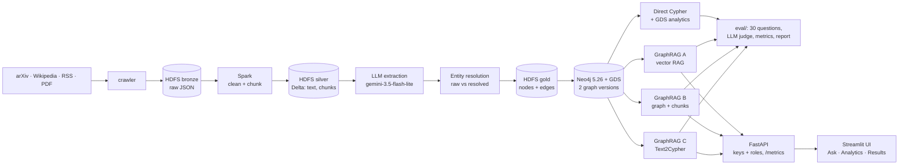
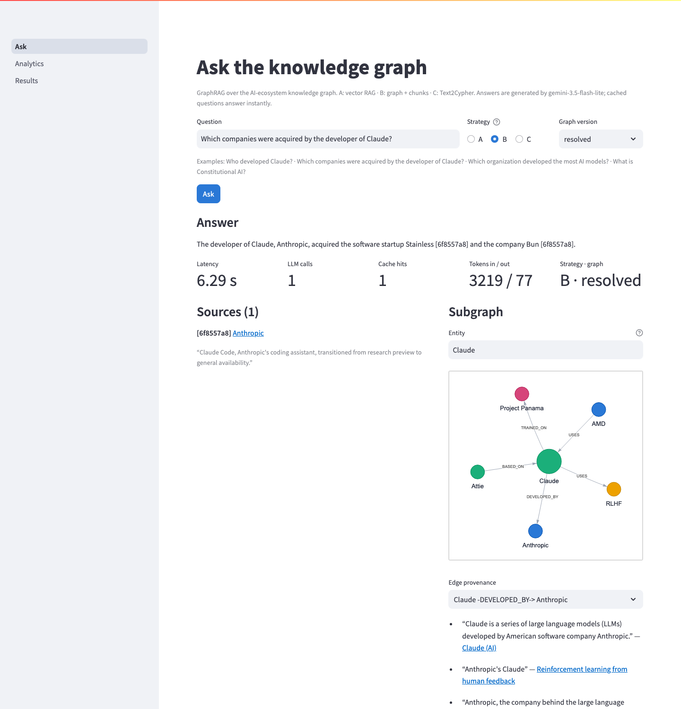
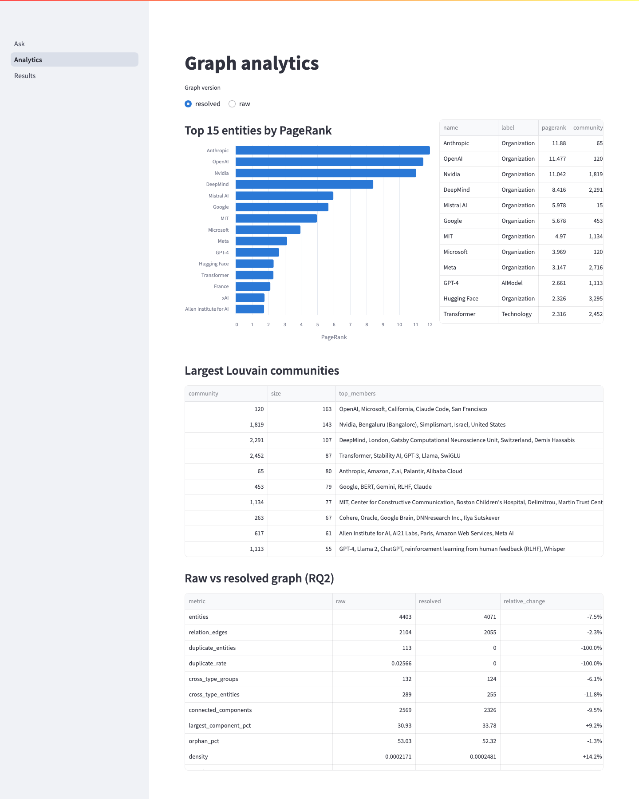
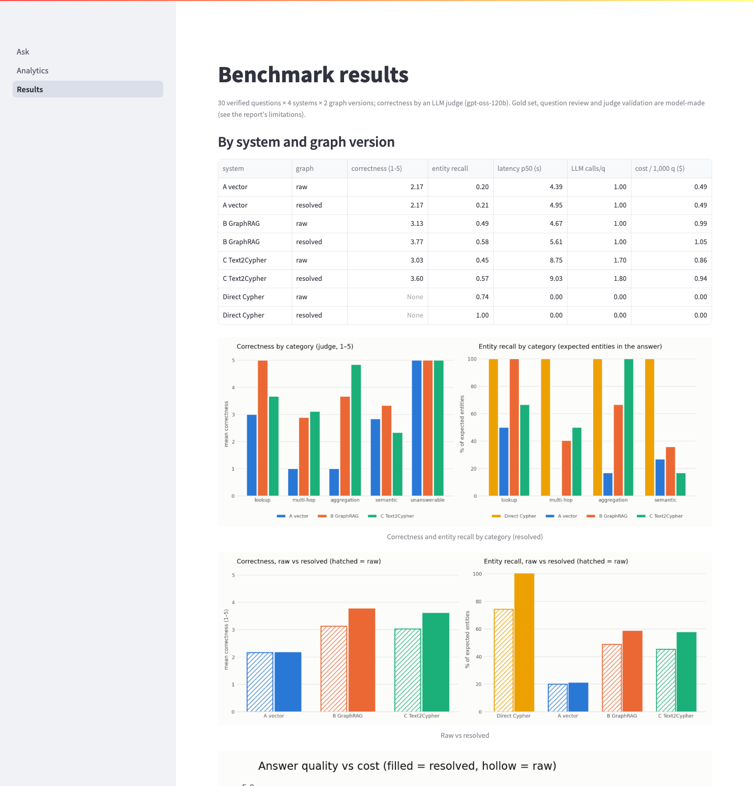

# AI-Powered Knowledge Graph Analytics Platform

INPT Big Data Analytics project (Hamza, Mohamed). We crawl about 270 public documents about the AI ecosystem
(arXiv, Wikipedia, tech news, a few PDFs) into an HDFS data lake, clean and chunk them with Spark, extract
entities and relations with a free-tier LLM, merge duplicate entities, and load the result into one Neo4j
knowledge graph, in two versions: `raw` (no entity resolution) and `resolved`. On that graph we compare
**Graph Analytics** (Cypher queries and GDS algorithms) with **GraphRAG** (an LLM answering from graph context,
in three variants) on 30 verified questions, and answer five research questions on extraction quality, entity
resolution, answer quality, cost and provenance. A FastAPI service and a Streamlit interface make it usable
without writing code. Budget: $0 (free tiers only).

Development was assisted by AI coding tools; design choices, configuration and analysis were directed by the authors.

**Results:** [docs/benchmark_report.md](docs/benchmark_report.md) · Report (FR): [docs/rapport.pdf](docs/rapport.pdf)

## Architecture



Everything runs in one Docker Compose stack (HDFS 3.2.1, Spark 3.5.0, Neo4j 5.26 + GDS, Jupyter, Python services
built on one shared PySpark image). Every extracted relation keeps its provenance (document, chunk, evidence
sentence), and every LLM call is cached and logged to `logs/llm_calls.jsonl`.

## Results summary

| RQ | Question | Key result |
|---|---|---|
| RQ1 | How accurately does the LLM extract entities and relations? | Entity F1 0.84, relation F1 0.47 (precision 0.75, recall 0.34), against a blind annotation of 25 chunks by a second model |
| RQ2 | How does entity resolution change the graph? | The answer to "which organization developed the most AI models?" flips from Anthropic (33) on raw to DeepMind (34) on resolved; gold-query entity recall 74% → 100% |
| RQ3 | GraphRAG vs direct Cypher? | Best GraphRAG (B) 3.77/5 correctness and 58% entity recall; the gold Cypher finds 100%. Text2Cypher is best on aggregations (4.83/5) |
| RQ4 | Quality / latency / cost trade-offs | Cypher: no tokens, under 0.01 s. GraphRAG: 5–9 s median, $0.49–$1.05 per 1,000 questions at paid list prices |
| RQ5 | Does provenance help? | Every answer shows its evidence; the judge finds 54–73% of claims supported (B, C) and catches fabricated citations |

All numbers come from `eval/results/`. Main caveat: the
RQ1 gold set, the question review and the judge validation were done by models, not humans (see the report's
limitations).

## Prerequisites (free tiers only)

- Docker Desktop with 6 GB of memory for the default `lite` stack (10 GB for `STACK=full`). On Apple Silicon,
  turn on "Use Rosetta for x86/amd64 emulation" (the course HDFS images are amd64).
- `make`, `git`, `python3` on the host.
- A **Gemini API key** (Google AI Studio, free tier: 500 requests/day for `gemini-3.5-flash-lite`).
- A **Groq API key** (free tier) for the answer judge and the inter-model judge validation.
- Optional, slides only: python-pptx in a local venv (`make presentation` creates it).

## Setup from a fresh clone

```bash
git clone <this repo> kg-analytics && cd kg-analytics
make env        # creates .env from .env.example
```

Edit `.env` (never committed):

| Variable | What |
|---|---|
| `NEO4J_PASSWORD` | any password, min 8 characters |
| `GEMINI_API_KEY` | Gemini free-tier key |
| `GROQ_API_KEY` | Groq free-tier key |
| `EXTRACTION_MODEL`, `ANSWER_MODEL` | `gemini-3.5-flash-lite` (default) |
| `JUDGE_MODEL` | `openai/gpt-oss-120b` (default) |
| `API_KEYS_ADMIN`, `API_KEYS_VIEWER`, `UI_API_KEY` | API keys for the app; `make api-keys` generates random ones |

The other variables in `.env.example` (memory, retries, throttling) have working defaults.

## Demo: the application

```bash
make demo       # starts the stack + API + UI, generates API keys in .env if missing
```

Then open **http://localhost:8501** (UI: Ask, Analytics, Results) or **http://localhost:8000/docs** (API, send
`X-API-Key` from `.env`). Questions already in the cache (the 30 benchmark questions) answer without any LLM call;
new questions use the Gemini free tier. `make demo-down` stops the API and UI.

| Ask | Analytics | Results |
|---|---|---|
|  |  |  |

API: `POST /ask` (strategy `A|B|C`, `kg_version`), `GET /analytics/top`, `GET /analytics/communities`,
`GET /provenance/{edge_id}`, `GET /graph/neighbours`, `GET /health`, `GET /metrics` (admin). Viewer keys can only ask
and read; every Cypher query is read-only. Each request writes one JSON log line (`logs/api.jsonl`).

## One-command reproduction

```bash
make all ok=1   # whole pipeline; resumable — re-run it the next day when a quota stops it
make all        # same without any LLM call: runs the no-LLM steps and prints the planned calls
make dry-run    # no LLM: unit tests, benchmark plan, report + number check from the stored results
make test       # unit tests (crawler, extraction, loader, graphrag, eval, spark jobs, analytics, API): 114 tests
```

`make all` runs: `up` → `crawl` → `silver` → `extract` → `resolve` → `gold` → `neo4j-load` → `analytics` →
`rq1` → `benchmark` → `judge` → `judge-validate` → `report`. Every LLM call is cached, so a re-run never repeats
a finished call, and every LLM step stops cleanly when the daily quota is reached.

**Expected runtime and quota from scratch** (measured on an 8 GB Mac, lite stack):

| Step | Time | Quota |
|---|---|---|
| Image build (first time) | 10–30 min (network-bound) | – |
| Crawl + Spark silver | about 10 min | – |
| Extraction of 642 chunks | 2 days | about 690 Gemini requests (500/day) |
| Entity resolution, gold, Neo4j load, analytics | about 20 min | about 40 Gemini requests (ER adjudication) |
| Benchmark (30 questions × 4 systems × 2 graphs) | about 30 min | 204 Gemini requests |
| Judge + inter-model validation | about 20 min | 103 + 15 Groq calls |

So a full reproduction from an empty cache takes **3 days of free quota**; with the committed results,
`make report` and `make dry-run` regenerate every table, figure and number in minutes without any LLM call.

Individual phases have their own targets and acceptance tests (`make help`, `make test-phase0` … `make test-phase6`).

## Repository map

| Path | What |
|---|---|
| `infra/` | Docker Compose (lite/full), Dockerfiles, shared PySpark image |
| `services/crawler/` | arXiv, Wikipedia, RSS and local-file crawler → HDFS bronze |
| `spark_jobs/` | bronze → silver (clean, chunk) and silver → gold (graph tables), Delta Lake |
| `services/extraction/` | LLM extraction, entity resolution, LLM client with cache, throttling and call log |
| `services/loader/`, `neo4j/` | gold → Neo4j (both graph versions, embeddings, vector indexes), schema |
| `analytics/` | Cypher query library and GDS algorithms (PageRank, Louvain, …), RQ2 graph quality |
| `services/graphrag/` | GraphRAG engine: A vector, B hybrid GraphRAG, C Text2Cypher |
| `services/api/` | FastAPI service: ask, analytics, provenance, metrics; API-key roles; JSON logs |
| `ui/` | Streamlit interface (Ask, Analytics, Results) |
| `eval/` | questions + gold Cypher, benchmark runner, judge, metrics, RQ1 scoring, report; `eval/results/` holds every result |
| `docs/` | report, figures, slides, Q&A prep, decisions, run log, phase notes, course material |
| `tests/` | unit tests per component |
| `notebooks/` | exploration and the Phase 4 analytics notebook |

## Services and ports (all bound to 127.0.0.1)

| Service | URL |
|---|---|
| Neo4j Browser | http://localhost:7474 (login from `.env`) |
| HDFS namenode UI | http://localhost:9870 |
| Spark master UI | http://localhost:8080 |
| Jupyter Lab (Spark driver) | http://localhost:8888 |
| UI (Streamlit) | http://localhost:8501 |
| API (FastAPI docs) | http://localhost:8000/docs |

Ask the GraphRAG assistant a question: `make ask q="Who developed Claude?" s=B kg=resolved`.
