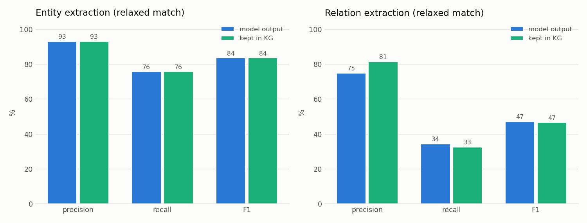
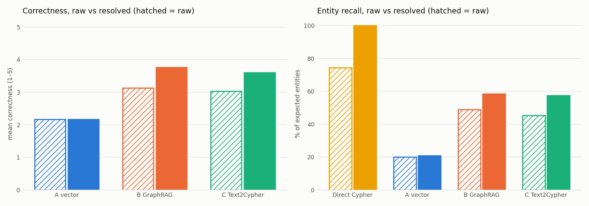
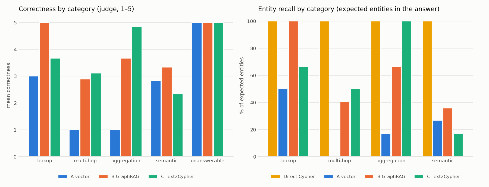
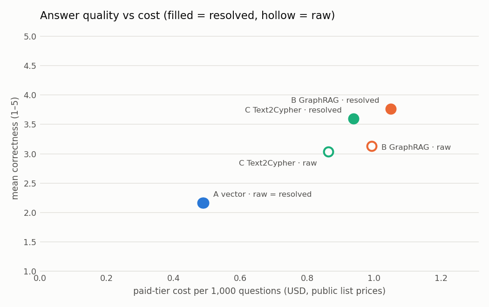
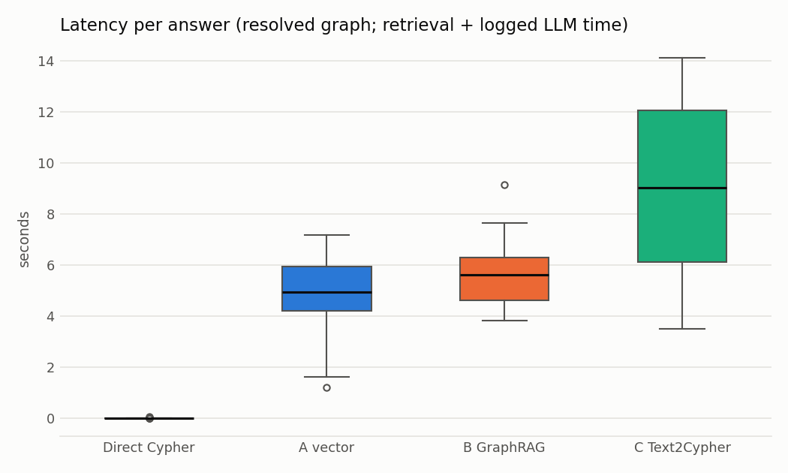

# Benchmark report: Graph Analytics vs GraphRAG on the AI-ecosystem knowledge graph

_Generated by `python -m eval.report` on 2026-10-31 from stored results only (`eval/results/`, `logs/llm_calls.jsonl`). Every number below is read from those files; `scripts/check_report_numbers.py` fails the build if one is not._

## In one page: what we built, what we found, why it matters

**What we built.** A pipeline that crawls public documents about the AI ecosystem (Wikipedia, arXiv, tech news, a few local PDFs) into an HDFS data lake, cleans and chunks them with Spark, extracts entities and relations with a free-tier LLM, merges duplicate entities (entity resolution), and loads two versions of one Neo4j knowledge graph: `raw` (no merging) and `resolved`. On that graph we compare two ways to answer questions: **Graph Analytics** (a Cypher query written for the question, plus GDS algorithms) and **GraphRAG** (an LLM answers from retrieved context: A vector search over chunks, B graph neighbourhood + chunks, C the LLM writes the Cypher itself).

**What we found.** On 30 verified questions:

- **Extraction (RQ1):** the LLM finds entities well (F1 0.84) but misses most relations (recall 0.34, F1 0.47) against a second model's annotation; what it does extract is mostly right (relation precision 0.75).
- **Entity resolution (RQ2):** it changes answers, not just counts. "Which organization developed the most AI models?" gets `entity: Anthropic; n: 33` on the raw graph and `entity: DeepMind; n: 34` on the resolved one: before merging, DeepMind's models were split over duplicate DeepMind nodes. The gold queries find 74% of the expected entities on raw vs 100% on resolved.
- **GraphRAG vs Cypher (RQ3):** the best GraphRAG variant (B GraphRAG) reaches mean correctness 3.77/5 and finds 58% of the expected entities; the hand-written Cypher finds 100%. GraphRAG answers open questions in natural language; Cypher wins on counts and rankings.
- **Cost (RQ4):** a Cypher query costs no tokens and answers within 0.01 s (p95); GraphRAG takes 4.95–9.03 s and would cost $0.49–$1.05 per 1,000 questions on a paid tier. This project spent $0.
- **Provenance (RQ5):** every graph fact carries its source sentence, so a reader can check an answer; 54% of GraphRAG-B's claims are supported by the evidence it shows.

**Why it matters.** The two approaches are complementary, not rivals. When the question has a known shape (who, how many, which is largest), a Cypher query over a clean graph is exact, instant and free, but someone must write it. GraphRAG accepts any question and explains itself with sources, at the price of tokens, seconds and some wrong answers. Both depend on the same foundation: if extraction misses relations or duplicates are not merged, every method above inherits the error. The honest caveat: the question set is small, the gold sets and the judge validation were made by models, not humans (see the limitations).

## Setup

- **Questions:** 30 verified in `eval/gold/questions.jsonl`: lookup 6, multi-hop 9, aggregation 6, semantic 6, unanswerable 3. Each has a gold Cypher query, an expected answer and expected entities; multi-hop anchors are in the largest connected component.
- **Systems:** Direct Cypher (the gold query, no LLM), A vector RAG, B GraphRAG hybrid, C Text2Cypher, each on both graph versions (`raw`, `resolved`). Answers stored: 240; runs that failed after 2 retries: 0.
- **Models:** answers by `gemini-3.5-flash-lite` (Gemini free tier, temperature 0); judge `openai/gpt-oss-120b (Groq)` (another model family, fixed rubric `judge-v1`). Judged answers: 103; 'Not found' answers scored by rule: 77; Direct Cypher is not judged (it is the gold query); pending: 0.
- **Authorship:** Development was assisted by AI coding tools; design choices, configuration and analysis were directed by the authors.
- **Model-made substitutes for human steps** (this is a model-graded study; see the limitations):
  - question review: **model-reviewed (an LLM), not human-reviewed** (`eval/gold/questions_review.md` gives the reason of every fix);
  - RQ1 gold annotation: **model-annotated (an LLM blind to the extractor's output)**, so RQ1 measures agreement between two models;
  - judge validation: **inter-model agreement, not human validation** (a second Groq model re-scores 15 answers).

### Overall results

| System | KG | Correctness (1-5) | Correct (≥4) | Entity recall | Entity F1 | Faithfulness | Citation precision | False refusals | Refused unanswerable | Latency p50 (s) | Latency p95 (s) | LLM calls/q | Tokens in/q | Tokens out/q | Cost/q (paid) |
|---|---|---|---|---|---|---|---|---|---|---|---|---|---|---|---|
| A vector | raw | 2.17 | 27% | 20% | 18% | 58% | 62% | 70% | 100% | 4.39 | 4.63 | 1.00 | 1292 | 40 | $0.00049 |
| A vector | resolved | 2.17 | 27% | 21% | 19% | 67% | 67% | 67% | 100% | 4.95 | 7.02 | 1.00 | 1292 | 41 | $0.00049 |
| B GraphRAG | raw | 3.13 | 43% | 49% | 45% | 43% | 47% | 19% | 100% | 4.67 | 5.07 | 1.00 | 2794 | 62 | $0.00099 |
| B GraphRAG | resolved | 3.77 | 63% | 58% | 58% | 54% | 61% | 15% | 100% | 5.61 | 7.39 | 1.00 | 2952 | 66 | $0.00105 |
| C Text2Cypher | raw | 3.03 | 47% | 45% | 46% | 62% | 82% | 26% | 100% | 8.75 | 9.63 | 1.70 | 1351 | 183 | $0.00086 |
| C Text2Cypher | resolved | 3.60 | 63% | 57% | 57% | 73% | 82% | 22% | 100% | 9.03 | 13.84 | 1.80 | 1438 | 203 | $0.00094 |
| Direct Cypher | raw | – | – | 74% | 71% | – | – | 15% | 100% | 0.00 | 0.00 | 0.00 | 0 | 0 | $0.00000 |
| Direct Cypher | resolved | – | – | 100% | 94% | – | – | 0% | 100% | 0.00 | 0.01 | 0.00 | 0 | 0 | $0.00000 |

## RQ1 — How accurately does the LLM extract entities and relations?

**Question.** How well does the extraction model (`gemini-3.5-flash-lite`) recover the entities and relations a text states?

**Method.** 25 chunks sampled across the four sources, annotated from the text alone (blind, `annotator: model`). The model's cached extraction of each chunk is scored with micro precision / recall / F1, strict (same name and type) and relaxed (normalised name or token containment), in two views: everything the model returned, and only the relations kept in the graph after the post-hoc checks (known endpoints, schema, evidence found in the text, no self-loop).

**Results** (25/25 chunks, model `gemini-3.5-flash-lite`):

| View | Match | Entity P | Entity R | Entity F1 | Relation P | Relation R | Relation F1 |
|---|---|---|---|---|---|---|---|
| model output | strict | 0.87 | 0.71 | 0.78 | 0.72 | 0.33 | 0.45 |
| model output | relaxed | 0.93 | 0.76 | 0.84 | 0.75 | 0.34 | 0.47 |
| kept in KG | strict | 0.87 | 0.71 | 0.78 | 0.81 | 0.33 | 0.47 |
| kept in KG | relaxed | 0.93 | 0.76 | 0.84 | 0.81 | 0.33 | 0.47 |

**Interpretation.** Entities are the easy part: relaxed F1 0.84, with precision (0.93) above recall (0.76). Relations are the bottleneck: the model returns few of them, so recall is 0.34, while most of those it returns are right (0.75). The post-hoc checks raise strict relation precision from 0.72 to 0.81 while recall only moves from 0.33 to 0.33: they remove wrong edges, not useful ones. The gold is a second model's reading of the text, denser than the extraction prompt asks for (e.g. every board member as WORKS_AT), so recall is a lower bound.

**Verdict.** Accurate but incomplete: entity extraction is usable as is (F1 0.84); relation extraction is precise but misses most stated relations (F1 0.47), which caps what any graph method can answer.

## RQ2 — How does entity resolution change KG quality?

**Question.** Does merging duplicate entities make the graph, and the answers built on it, better?

**Method.** The same extraction is loaded twice: `raw` (one node per surface name) and `resolved` (after entity resolution). We compare graph structure (Phase 4) and run every benchmark question on both versions, paired by question.

**Results — graph structure** (`eval/results/rq2_graph_quality.csv`):

| Metric | Raw | Resolved | Change |
|---|---|---|---|
| Entities | 4403 | 4071 | -7.5% |
| Relation edges | 2104 | 2055 | -2.3% |
| Same-type duplicate entities | 113 | 0 | -100.0% |
| Duplicate rate | 2.57% | 0.00% | -100.0% |
| Cross-type duplicate names | 132 | 124 | -6.1% |
| Entities in cross-type duplicates | 289 | 255 | -11.8% |
| Connected components | 2569 | 2326 | -9.5% |
| Largest component % | 30.9 | 33.8 | +9.2% |
| Orphan entities % | 53.0 | 52.3 | -1.3% |
| Density | 0.000217 | 0.000248 | +14.3% |
| Average degree | 0.956 | 1.010 | +5.6% |
| Louvain communities | 2590 | 2348 | -9.3% |
| Louvain communities (size >= 2) | 255 | 218 | -14.5% |

**Headline example — the answer itself changes.** G01 "Which organization developed the most AI models?": the gold Cypher query returns `entity: Anthropic; n: 33` on the raw graph and `entity: DeepMind; n: 34` on the resolved graph.
ER merged **6 raw DeepMind entities** into one; its PageRank went from 5.039 (best raw member, rank 9) to 8.416 (rank 4). Before ER, DeepMind's models were split over its duplicates, so no single DeepMind node had the most models and the count crowned Anthropic.

**Results — answers on the two graphs** (same questions, paired):

| System | Pairs | Correctness raw | Correctness resolved | Entity recall raw | Entity recall resolved | Better on resolved | Better on raw |
|---|---|---|---|---|---|---|---|
| Direct Cypher | 30 | – | – | 74% | 100% | 0 | 0 |
| A vector | 30 | 2.17 | 2.17 | 20% | 21% | 1 | 1 |
| B GraphRAG | 30 | 3.13 | 3.77 | 49% | 58% | 7 | 0 |
| C Text2Cypher | 30 | 3.03 | 3.60 | 45% | 57% | 9 | 4 |

**Interpretation.** For structured access the effect is large: the gold queries return a different result on the raw graph for 20 of 30 questions, and their entity recall drops from 100% to 74%, because a query anchored on one name only sees the edges of that duplicate. For the LLM systems mean correctness goes from raw to resolved as A vector 2.17 → 2.17, B GraphRAG 3.13 → 3.77, C Text2Cypher 3.03 → 3.60: A reads only chunks, which are identical in both versions, so it cannot benefit; B and C use entities and edges, and gain from the merged graph.

**Verdict.** Entity resolution is necessary for anything that uses the graph's structure: without it, counts, rankings and centrality are wrong, not just noisier, and graph-based GraphRAG (B, C) answers worse. Chunk-only RAG (A) does not see it.

## RQ3 — GraphRAG vs direct Cypher on multi-hop and semantic questions

**Question.** Can an LLM over retrieved graph context replace a Cypher query written for the question?

**Method.** All questions on the resolved graph, by category. GraphRAG answers are scored by the judge (1–5 against the expected answer) and by entity recall (expected entities named in the answer). Direct Cypher is the gold query: an upper bound by construction for structured questions, scored by entity recall only.

**Results** (resolved graph):

| Category | System | Correctness (1-5) | Correct (≥4) | Entity recall | Entity F1 | False refusals | Refused unanswerable | LLM calls/q |
|---|---|---|---|---|---|---|---|---|
| aggregation | A vector | 1.00 | 0% | 17% | 17% | 83% | – | 1.00 |
| aggregation | B GraphRAG | 3.67 | 67% | 67% | 67% | 33% | – | 1.00 |
| aggregation | C Text2Cypher | 4.83 | 100% | 100% | 100% | 0% | – | 2.17 |
| aggregation | Direct Cypher | – | – | 100% | 100% | 0% | – | 0.00 |
| lookup | A vector | 3.00 | 50% | 50% | 44% | 50% | – | 1.00 |
| lookup | B GraphRAG | 5.00 | 100% | 100% | 100% | 0% | – | 1.00 |
| lookup | C Text2Cypher | 3.67 | 67% | 67% | 67% | 33% | – | 1.67 |
| lookup | Direct Cypher | – | – | 100% | 94% | 0% | – | 0.00 |
| multi-hop | A vector | 1.00 | 0% | 0% | 0% | 100% | – | 1.00 |
| multi-hop | B GraphRAG | 2.89 | 44% | 40% | 41% | 22% | – | 1.00 |
| multi-hop | C Text2Cypher | 3.11 | 56% | 50% | 47% | 44% | – | 1.67 |
| multi-hop | Direct Cypher | – | – | 100% | 91% | 0% | – | 0.00 |
| semantic | A vector | 2.83 | 33% | 27% | 22% | 17% | – | 1.00 |
| semantic | B GraphRAG | 3.33 | 33% | 36% | 33% | 0% | – | 1.00 |
| semantic | C Text2Cypher | 2.33 | 17% | 17% | 17% | 0% | – | 2.17 |
| semantic | Direct Cypher | – | – | 100% | 93% | 0% | – | 0.00 |
| unanswerable | A vector | 5.00 | 100% | – | – | – | 100% | 1.00 |
| unanswerable | B GraphRAG | 5.00 | 100% | – | – | – | 100% | 1.00 |
| unanswerable | C Text2Cypher | 5.00 | 100% | – | – | – | 100% | 1.00 |
| unanswerable | Direct Cypher | – | – | – | – | – | 100% | 0.00 |

- **lookup:** B GraphRAG 5.00, C Text2Cypher 3.67, A vector 3.00.
- **multi-hop:** C Text2Cypher 3.11, B GraphRAG 2.89, A vector 1.00.
- **aggregation:** C Text2Cypher 4.83, B GraphRAG 3.67, A vector 1.00.
- **semantic:** B GraphRAG 3.33, A vector 2.83, C Text2Cypher 2.33.
- **unanswerable:** C Text2Cypher 5.00, B GraphRAG 5.00, A vector 5.00.

**Interpretation.** Multi-hop questions: Direct Cypher finds 100% of the expected entities, GraphRAG A vector 0%, B GraphRAG 40%, C Text2Cypher 50%. Aggregations separate the systems most (mean correctness A vector 1.00, B GraphRAG 3.67, C Text2Cypher 4.83): top-k chunks cannot contain a global count, B's context adds graph aggregates, and Text2Cypher computes the count itself. Multi-hop lists are the weak spot of every LLM system: a missed hop or a reversed edge empties the answer.

**Verdict.** No: GraphRAG does not replace Cypher for structured questions (multi-hop lists, counts, rankings), where the gold query is exact. It complements it for open questions, and Text2Cypher is the bridge: an LLM that writes the query keeps Cypher's exactness when it gets the query right.

## RQ4 — Trade-offs: quality, completeness, latency, cost

**Question.** What does each approach cost in answer quality, completeness, time and money?

**Method.** Per answer: judge correctness, entity recall, latency (retrieval time measured in the run plus the logged latency of each LLM call), LLM calls and tokens from the call log, and the paid-tier price of those tokens at public list prices (`eval/prices.json`).

**Results:**

| System | KG | Correctness | Entity recall | Latency p50 (s) | Latency p95 (s) | LLM calls/q | Tokens in/q | Tokens out/q | Paid cost / 1,000 q |
|---|---|---|---|---|---|---|---|---|---|
| A vector | raw | 2.17 | 20% | 4.39 | 4.63 | 1.00 | 1292 | 40 | $0.49 |
| A vector | resolved | 2.17 | 21% | 4.95 | 7.02 | 1.00 | 1292 | 41 | $0.49 |
| B GraphRAG | raw | 3.13 | 49% | 4.67 | 5.07 | 1.00 | 2794 | 62 | $0.99 |
| B GraphRAG | resolved | 3.77 | 58% | 5.61 | 7.39 | 1.00 | 2952 | 66 | $1.05 |
| C Text2Cypher | raw | 3.03 | 45% | 8.75 | 9.63 | 1.70 | 1351 | 183 | $0.86 |
| C Text2Cypher | resolved | 3.60 | 57% | 9.03 | 13.84 | 1.80 | 1438 | 203 | $0.94 |
| Direct Cypher | raw | – | 74% | 0.00 | 0.00 | 0.00 | 0 | 0 | $0.00 |
| Direct Cypher | resolved | – | 100% | 0.00 | 0.01 | 0.00 | 0 | 0 | $0.00 |

**Interpretation.** Direct Cypher dominates on every axis it can be measured on, but it needs a person (or Text2Cypher) to write the query. Among the LLM systems, A vector is the cheapest per question; C makes up to 3 calls (query, retry, verbalisation), so it is the slowest at the tail (p95 13.84 s). At list prices every variant stays below $1.05 per 1,000 questions: money is not the constraint, the free tier's 500 requests/day and the seconds of latency are.

**Verdict.** Quality and completeness favour the structured path, latency and cost favour it by orders of magnitude; GraphRAG buys flexibility (any question, natural-language answers with sources) with seconds and tokens.

## RQ5 — Does source provenance improve reliability and explainability?

| System | KG | Answers with sources | Faithfulness | Citation precision | Invalid citations removed |
|---|---|---|---|---|---|
| A vector | raw | 100% | 58% | 62% | 0 |
| A vector | resolved | 100% | 67% | 67% | 0 |
| B GraphRAG | raw | 100% | 43% | 47% | 1 |
| B GraphRAG | resolved | 100% | 54% | 61% | 0 |
| C Text2Cypher | raw | 100% | 62% | 82% | 1 |
| C Text2Cypher | resolved | 100% | 73% | 82% | 1 |

Faithfulness = share of the answer's claims supported by the evidence shown with it; citation precision = share of shown sources whose evidence supports the answer (both judged).

**Concrete examples:**

- **Fabricated citation caught** (benchmark, C Text2Cypher, "What is DeepMind known for?"): the model cited `['66848']`, which is not a source id of its context. It was removed from the answer and reported, never shown as a source.
- **WORKS_AT investor error** (questions M01/M09): the graph holds `(Jaan Tallinn)-[:WORKS_AT]->(DeepMind)`, extracted from the sentence "Jaan Tallinn was an early investor and an adviser to the company." The review removed him from the expected answer; the gold Cypher still returns him. GraphRAG repeats the error ("Which people work at the organization that developed AlphaFold?", C Text2Cypher), but the evidence sentence shipped with the edge lets a reader see that the source talks about an investment.
- **Supporting sources** (C Text2Cypher, "What is DeepMind known for?"): the Text2Cypher rows had no document ids, so the answer shows chunks that mention the entities, marked as not cited by the model.

## Good and bad answers per system (resolved graph)

Ranked by judge correctness, then entity F1 (Direct Cypher: entity F1). Answers are shortened.

### Direct Cypher

| | Question | Answer | Correctness | Entity recall |
|---|---|---|---|---|
| good | S06 What is Geoffrey Hinton known for? | description: Geoffrey Hinton; entity: AlexNet description: Geoffrey Hinton; entity: Boltzmann machines description: Geoffrey Hinton; entity: DNNresearch Inc. description: Geoffrey Hinton; entity: t-SNE | – | 100% |
| good | S03 What is the Transformer architecture? | description: a family of artificial neural network architectures based on the multi-head attention mechanism; entity: GPT-4 description: a family of artificial neural network architectures based on the multi-head … | – | 100% |
| good | S02 What is Constitutional AI? | description: method for training a harmless AI assistant through self-improvement; entity: Anthropic | – | 100% |
| bad | L05 Which company developed GPT-4? | entity: OpenAI entity: Microsoft | – | 100% |
| bad | M01 Which people work at the organization that developed AlphaFold? | via: DeepMind; entity: Demis Hassabis via: DeepMind; entity: David Silver via: DeepMind; entity: Aja Huang via: DeepMind; entity: Arthur Mensch via: DeepMind; entity: Diego Rivas via: DeepMind; entity: Fan Hui via: … | – | 100% |
| bad | M03 Which companies were acquired by the developer of Claude? | via: Anthropic; entity: Stainless via: Anthropic; entity: Bun | – | 100% |

### A vector

| | Question | Answer | Correctness | Entity recall |
|---|---|---|---|---|
| good | L05 Which company developed GPT-4? | GPT-4 was developed by OpenAI. | 5 | 100% |
| good | L01 Who developed Claude? | Claude is developed by the American software company Anthropic. | 5 | 100% |
| good | L02 Where is Cohere headquartered? | Cohere is headquartered in Toronto, Ontario, Canada. | 5 | 100% |
| bad | G01 Which organization developed the most AI models? | Not found in the knowledge graph. | 1 | 0% |
| bad | G02 How many AI models did Mistral AI develop? | Not found in the knowledge graph. | 1 | 0% |
| bad | G03 Which organization has acquired the most companies? | Not found in the knowledge graph. | 1 | 0% |

### B GraphRAG

| | Question | Answer | Correctness | Entity recall |
|---|---|---|---|---|
| good | M05 Which AI models were developed by the company that acquired Aleph Alpha? | The company that acquired Aleph Alpha is Cohere [666ca983]. The AI models developed by Cohere include Aya Vision [666ca983] and Takane [666ca983]. | 5 | 100% |
| good | L06 Which companies has Mistral AI acquired? | Mistral AI has acquired the Austrian company Emmi AI and the Paris-based AI startup Koyeb. | 5 | 100% |
| good | L05 Which company developed GPT-4? | GPT-4 was developed by OpenAI. | 5 | 100% |
| bad | G03 Which organization has acquired the most companies? | Not found in the knowledge graph. | 1 | 0% |
| bad | G05 Which person has worked at the most organizations? | Not found in the knowledge graph. | 1 | 0% |
| bad | M04 Who founded the company that acquired Mellanox? | Not found in the knowledge graph. | 1 | 0% |

### C Text2Cypher

| | Question | Answer | Correctness | Entity recall |
|---|---|---|---|---|
| good | S02 What is Constitutional AI? | Constitutional AI is a method developed by Anthropic for training a harmless AI assistant through self-improvement. | 5 | 100% |
| good | M07 Which people work at the company that developed Aya Vision? | The people who work at Cohere, the company that developed Aya Vision, include Ivan Zhang, Martin Kon, Aidan N. Gomez, and Joëlle Pineau [8af7b305, 666ca983]. | 5 | 100% |
| good | M06 Where is the organization that developed ChatGPT located? | ChatGPT was developed by OpenAI, an organization located in San Francisco, California [cd4fc97f]. | 5 | 100% |
| bad | L03 Who founded Hugging Face? | Not found in the knowledge graph. | 1 | 0% |
| bad | L04 Who created the ImageNet dataset? | Not found in the knowledge graph. | 1 | 0% |
| bad | M03 Which companies were acquired by the developer of Claude? | Not found in the knowledge graph. | 1 | 0% |

## The five hardest questions

Lowest mean correctness over A, B and C on the resolved graph.

| Question | Category | Mean correctness | A / B / C | Refusals | Direct Cypher entity recall (resolved / raw) |
|---|---|---|---|---|---|
| M04 Who founded the company that acquired Mellanox? | multi-hop | 1.00 | 1 / 1 / 1 | 3/3 | 100% / 0% |
| M08 Who founded the company that invested in the developer of the Jamba model? | multi-hop | 1.00 | 1 / 1 / 1 | 2/3 | 100% / 0% |
| G03 Which organization has acquired the most companies? | aggregation | 2.33 | 1 / 1 / 5 | 2/3 | 100% / 100% |
| G05 Which person has worked at the most organizations? | aggregation | 2.33 | 1 / 1 / 5 | 2/3 | 100% / 100% |
| L03 Who founded Hugging Face? | lookup | 2.33 | 1 / 5 / 1 | 2/3 | 100% / 0% |

- **M04** — 'Founded by' is stored as (Organization)-[:DEVELOPED_BY]->(Person), an unusual direction: Text2Cypher wrote the arrow the other way and got 0 rows, and the Mellanox fact sits in a sentence about another Nvidia deal, which text retrieval does not surface for this question.
- **M08** — Three hops through a FUNDED_BY edge that one investor sentence supports; text retrieval rarely puts the model, the investor and its founders in the same context.
- **G03** — A global argmax over ACQUIRED edges: invisible to top-k retrieval.
- **G05** — A global argmax over WORKS_AT; the graph's WORKS_AT edges also contain former roles, so even the right query counts a career, not a current job.
- **L03** — Same 'founded by' convention as M04: Text2Cypher queried (Person)-[:DEVELOPED_BY]->(Organization) and found nothing; only B, whose context lists the triple with its evidence, answered (5/5). A schema hint in the Text2Cypher prompt would fix both.

## Judge validation — inter-model agreement, not human validation

A second judge from another model family, `qwen/qwen3.8-27b` (Groq free tier), re-scored the same 15 answers (stratified by system and category) with the same rubric and the same blind prompt as `openai/gpt-oss-120b`. Errors: 1.

| Measure | Value |
|---|---|
| Correctness: exact agreement | 100% (n=14) |
| Correctness: within ±1 | 100% |
| Correctness: quadratic-weighted Cohen's κ | 1.00 |
| Correctness: Spearman ρ | 1.00 |
| Mean correctness: judge / second judge | 3.71 / 3.71 |
| Faithfulness: same 'fully supported' verdict | 92% (n=12) |
| Faithfulness: mean absolute difference | 0.13 |
| Citation precision: mean absolute difference | 0.09 (n=11) |

Perfect or near-perfect agreement on so few answers is weak evidence: most sampled answers are clear-cut (fully right or a refusal), and both judges read the same expected answer. 

Agreement between two LLMs shows the scores are not an artefact of one model's quirks; it does not show they match human judgement (both can share the same bias).

## Cost: tokens, calls, projected paid-tier cost

- **Benchmark answers:** 180 GraphRAG answers, 225 LLM calls, 333,559 input and 17,829 output tokens → **$0.1446** at `gemini-3.5-flash-lite` list prices ($0.30 / $2.50 per M tokens, official: https://ai.google.dev/gemini-api/docs/pricing).
- **Judge:** 103 calls, 69,854 input and 33,525 output tokens → **$0.0306** at $0.15 / $0.60 per M tokens (Groq price as reported by aggregator sites, not Groq's own page).
- **Actually paid:** $0. Every call ran on a free tier (Gemini 500 requests/day, Groq daily token limits).

**All LLM requests of the project** (`logs/llm_calls.jsonl`, incl. retries and errors):

| Phase | Model | Requests | OK | Tokens in | Tokens out | Median latency (s) |
|---|---|---|---|---|---|---|
| benchmark answers | gemini-3.5-flash-lite | 225 | 225 | 333,559 | 17,829 | 1.00 |
| extraction / ER | gemini-3.5-flash-lite | 690 | 652 | 873,254 | 497,665 | 12.52 |
| gold pre-fill | gemini-3.5-flash | 22 | 3 | 3,786 | 6,193 | 15.29 |
| gold pre-fill | openai/gpt-oss-120b | 79 | 22 | 32,448 | 39,524 | 4.19 |
| gold pre-fill | qwen/qwen3.8-27b | 1 | 1 | 1,632 | 2,048 | 4.90 |
| judge | openai/gpt-oss-120b | 94 | 93 | 63,531 | 31,136 | 1.08 |
| judge | qwen/qwen3.8-27b | 14 | 14 | 7,223 | 2,111 | 0.76 |
| other | gemini-3.5-flash-lite | 37 | 37 | 35,457 | 11,918 | 3.48 |

## Limitations and threats to validity

- **Model-made gold sets and question review.** The 25 RQ1 gold chunks were annotated by an LLM (blind to the extractor's output), and the 30 benchmark questions were reviewed by an LLM against the graph, not by a human. RQ1 therefore measures agreement between two models, and an error both models share is invisible.
- **Inter-model judge validation.** The judge was validated against a second LLM, not against human scores. High agreement rules out one model's idiosyncrasies, not a bias common to LLMs.
- **LLM-as-judge bias.** Correctness, faithfulness and citation precision come from an LLM with a fixed rubric; LLM judges tend to favour longer, fluent answers and can be lenient with partial lists. The judge sees the expected answer, is from a different family than the answer model, and 'Not found' answers are scored by rule.
- **Single run, no variance.** Each answer was generated once (temperature 0, cached). Free-tier latency varies with load; differences between systems of a few tenths of a point are within run-to-run noise we did not measure.
- **Small question set (n=30).** Per-category means rest on 3–9 questions: treat differences below about one point as noise.
- **Free-tier constraints.** One small answer model (`gemini-3.5-flash-lite`) because larger models allow 20 requests/day; results may not transfer to larger models. The 500 requests/day cap shaped the design (caching, one run per answer). Costs are projections from list prices.
- **Domain-specific corpus.** A few hundred English documents on the AI ecosystem (Wikipedia, arXiv, tech news, a few PDFs). The gold answers come from the resolved graph itself, which favours graph-based systems over vector RAG and makes Direct Cypher an upper bound by construction.
- **Rule-based components.** Entity linking (B) and the entity-mention metric use name matching, so aliases the graph does not know are missed by both.
