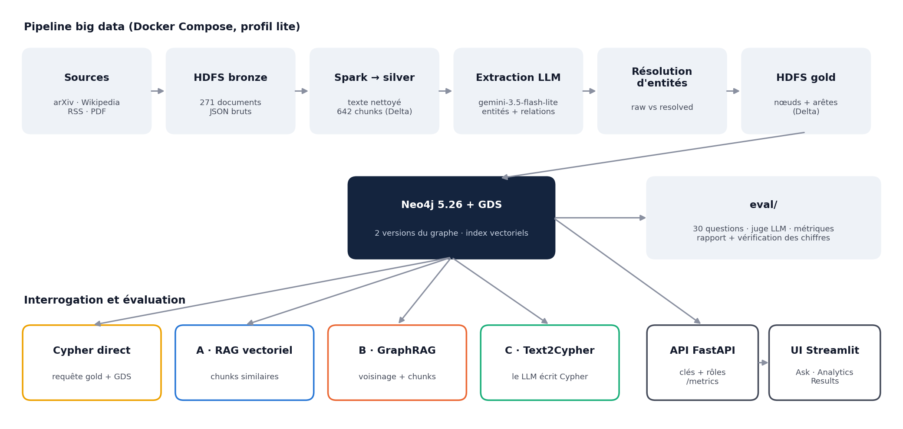
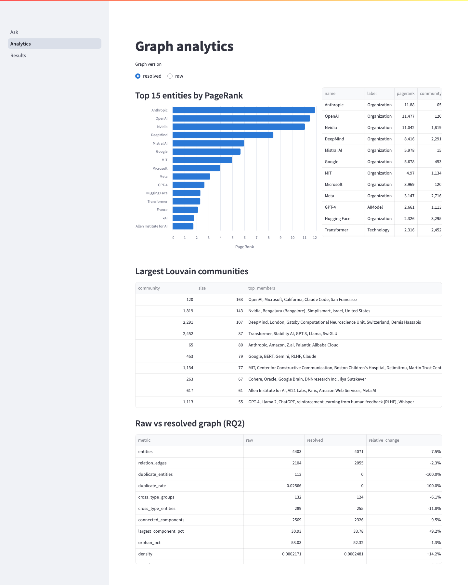
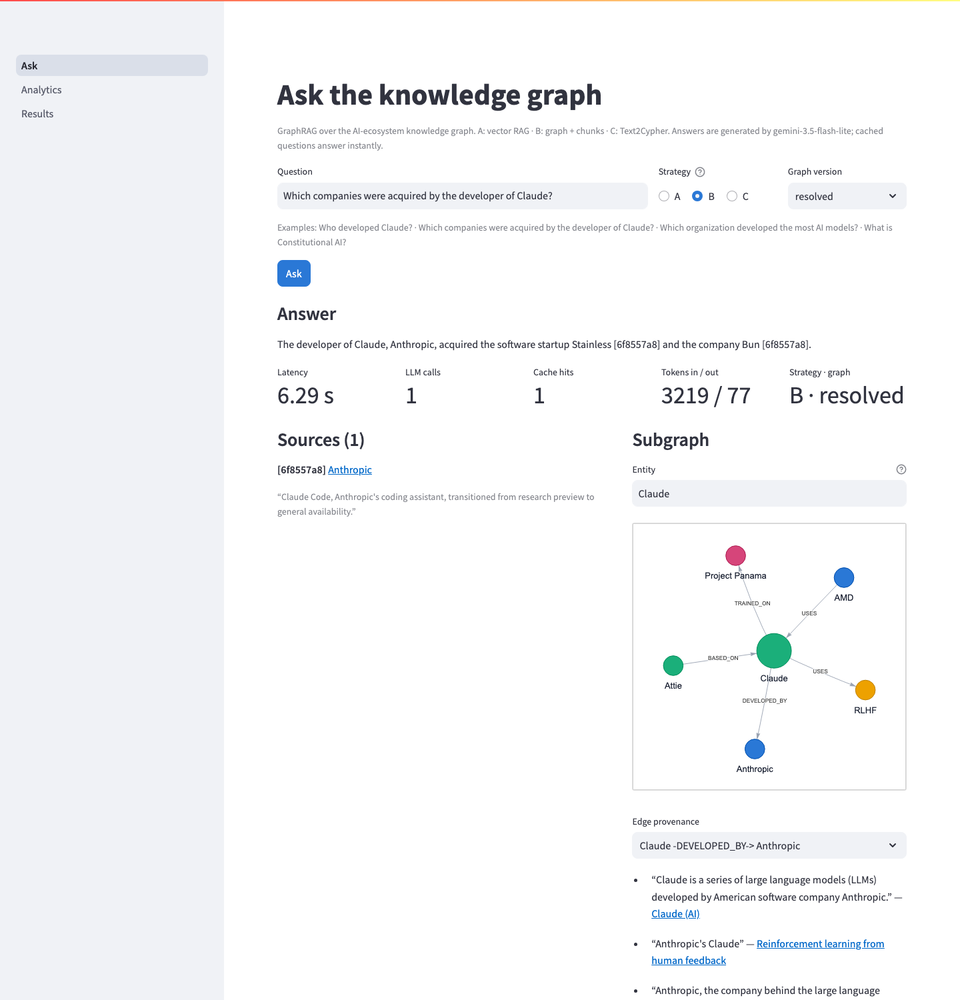
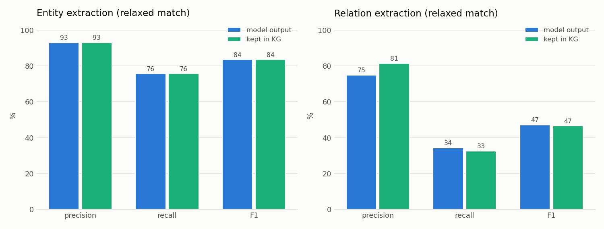
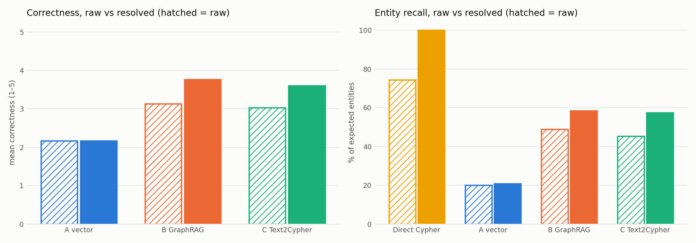
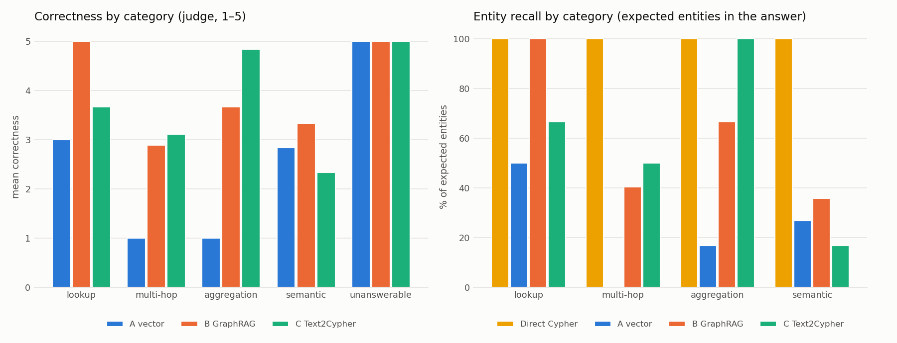
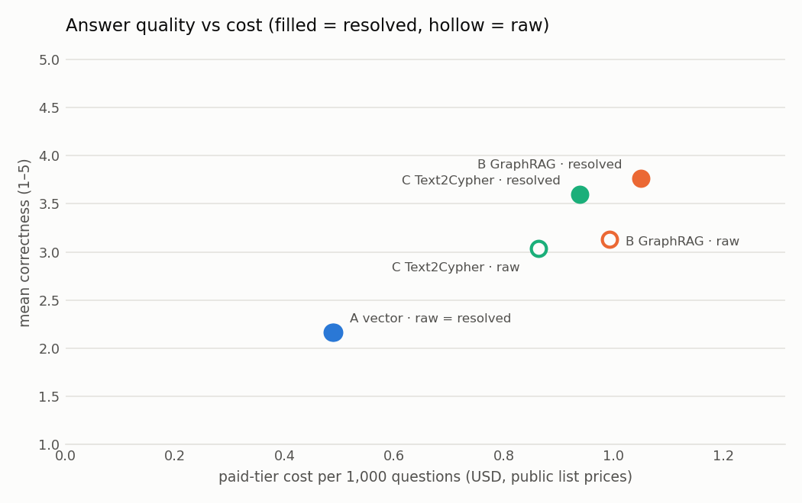

**Institut National des Postes et Télécommunications (INPT)**  
Module : Big Data Analytics · Année universitaire 2026–2027

**Auteurs :** Hamza El Hafidi, Boutament Mohamed

Version du 31/10/2026

*Le développement a été assisté par des outils de programmation IA ; les choix de conception, la configuration et l'analyse ont été dirigés par les auteurs.* (Development was assisted by AI coding tools; design choices, configuration and analysis were directed by the authors.)

## Résumé

Nous construisons un graphe de connaissances (Knowledge Graph, KG) de l'écosystème de l'IA à partir de 271 documents publics (arXiv, Wikipédia, flux RSS techniques, quelques PDF), avec une chaîne big data complète : lac de données HDFS en architecture médaillon, transformations Spark, extraction d'entités et de relations par un LLM gratuit (`gemini-3.5-flash-lite`), résolution d'entités, puis chargement dans Neo4j en deux versions (`raw`, sans résolution, et `resolved`). Sur ce graphe, nous comparons l'**analyse de graphe** (requêtes Cypher et algorithmes GDS) au **GraphRAG** (un LLM répond à partir d'un contexte extrait du graphe, en trois variantes) sur 30 questions vérifiées. L'extraction trouve bien les entités (F1 0,84) mais manque la plupart des relations (rappel 0,34). La résolution d'entités change les réponses elles-mêmes : la question « quelle organisation a développé le plus de modèles ? » donne Anthropic · 33 sur le graphe brut et DeepMind · 34 sur le graphe résolu. La meilleure variante GraphRAG atteint une correction moyenne de 3,77/5, contre un rappel d'entités de 100 % pour la requête Cypher de référence, qui ne consomme aucun token. Budget : 0 $ (offres gratuites). Les jeux de référence et la validation du juge ont été produits par des modèles, ce que nous traitons comme une menace à la validité.

**Mots-clés :** graphe de connaissances, GraphRAG, Neo4j, Spark, HDFS, extraction par LLM, résolution d'entités, LLM-juge.

## 1. Introduction et problématique

Les faits utiles sont dispersés dans des documents hétérogènes : la question « qui travaille dans le laboratoire qui a créé AlphaFold ? » demande de relier deux faits issus de deux sources. Un graphe de connaissances stocke ces faits sous forme de nœuds et d'arêtes, chacun avec sa provenance. Deux familles de méthodes l'exploitent : l'analyse de graphe, exacte mais qui exige d'écrire la requête, et la génération augmentée par la récupération (RAG) appliquée au graphe, qui accepte des questions libres mais dépend d'un LLM. La problématique de ce projet est de mesurer, sur un même graphe construit automatiquement, ce que chaque approche apporte et coûte, et à quel point la qualité du graphe (extraction, déduplication) conditionne les deux.

## 2. Questions de recherche

| | Question |
|---|---|
| RQ1 | Avec quelle précision un LLM extrait-il les entités et relations de documents hétérogènes ? |
| RQ2 | Comment la résolution d'entités change-t-elle la qualité du graphe ? |
| RQ3 | GraphRAG ou Cypher direct sur les questions multi-sauts et sémantiques ? |
| RQ4 | Quels compromis entre qualité, complétude, latence et coût d'inférence ? |
| RQ5 | La provenance des sources améliore-t-elle la fiabilité et l'explicabilité ? |

## 3. État de l'art

**Graphes de connaissances.** Un KG représente des entités et leurs relations typées ; le modèle de graphe de propriétés (Neo4j) attache des attributs aux nœuds et aux arêtes, ce qui permet d'y stocker la provenance [1, 2]. Les algorithmes de graphe classiques, comme PageRank [3] et Louvain [4], mesurent la centralité et la structure en communautés.

**Extraction par LLM et résolution d'entités.** Les LLM permettent une extraction ouverte d'entités et de relations guidée par un schéma, sans corpus annoté [5]. Les mentions extraites contiennent des doublons (variantes de noms) que la résolution d'entités fusionne, classiquement par normalisation, blocage et comparaison de similarité [6].

**RAG et GraphRAG.** Le RAG ajoute au prompt des passages retrouvés par similarité [7]. Le GraphRAG utilise la structure du graphe (voisinage d'entités, résumés de communautés) pour construire le contexte [8]. Une alternative est la traduction de la question en requête (Text2Cypher), qui conserve l'exactitude de la base si la requête est juste. L'évaluation des réponses libres repose souvent sur un LLM-juge, dont les biais sont documentés [9].

## 4. Architecture

Toute la plateforme tourne dans une seule pile Docker Compose (profil *lite*, environ 6 Go) : HDFS 3.2.1, Spark 3.5.0, Neo4j 5.26 avec Graph Data Science, Jupyter, et des services Python (collecte, extraction, chargement, GraphRAG, API, interface) construits sur une image PySpark commune. Chaque appel LLM est mis en cache et journalisé (modèle, tokens, latence), ce qui rend toutes les exécutions reprenables et fournit les mesures de coût de RQ4.

## 5. Collecte et pipeline de données

Le collecteur interroge l'API arXiv, l'API Wikipédia, des flux RSS techniques et quelques fichiers locaux, et écrit 271 documents (118 arXiv, 110 RSS, 39 Wikipédia, 4 locaux) dans la couche **bronze** de HDFS, sans jamais les modifier. Un job Spark produit la couche **silver** (Delta Lake) : texte nettoyé et 642 chunks d'environ 800 tokens avec chevauchement, puis, après extraction et résolution, la couche **gold** : tables de nœuds et d'arêtes prêtes pour le graphe. Le chargement dans Neo4j est idempotent et calcule les embeddings des chunks (fastembed, all-MiniLM-L6-v2, sans PyTorch).

## 6. Extraction LLM et résolution d'entités

Chaque chunk est envoyé une fois au LLM avec un schéma JSON validé par pydantic : 8 types d'entités (Organization, Person, AIModel, Paper, Technology, Dataset, Product, Location) et 12 types de relations (DEVELOPED_BY, WORKS_AT, USES, ACQUIRED, …). Chaque relation garde sa provenance : document, chunk, phrase d'évidence, confiance et modèle extracteur. Des contrôles a posteriori écartent les arêtes dont les extrémités, les types ou la phrase d'évidence ne tiennent pas. L'extraction a demandé 690 requêtes réparties sur deux jours à cause du quota gratuit de 500 requêtes par jour.

La résolution d'entités normalise les noms, regroupe les candidats par blocage, compare leurs embeddings et ne demande l'arbitrage du LLM que pour les paires ambiguës. Elle fait passer le graphe de 4403 à 4071 entités et de 2104 à 2055 arêtes ; le taux de doublons de même type passe de 2.57% à 0.00%. Les deux versions coexistent dans la même base : chaque entité et chaque relation porte `kg_version = raw | resolved`, et chaque requête filtre sur cette propriété.

## 7. Graphe Neo4j et analyses

Une bibliothèque de requêtes Cypher nommées (voisins, chemins, provenance d'une arête, classements) et les algorithmes GDS (PageRank, degré, intermédiarité, Louvain, composantes connexes) sont exécutés sur les deux versions ; leurs résultats sont réécrits sur les nœuds (`pagerank_resolved`, `community_raw`, …).

Exemple : la résolution a fusionné 6 nœuds DeepMind ; son PageRank passe de 5.039 (meilleur membre brut, rang 9) à 8.416 (rang 4).

## 8. GraphRAG A/B/C et Cypher direct

| Système | Principe | Appels LLM |
|---|---|---|
| Cypher direct | requête de référence écrite pour la question (gold), aucun LLM | 0 |
| A · RAG vectoriel | k chunks les plus proches de la question par similarité d'embedding | 1 |
| B · GraphRAG hybride | liaison d'entités, triplets à k sauts avec évidence, chunks (fusion RRF [10]), agrégats du graphe | 1 |
| C · Text2Cypher | le LLM écrit une requête Cypher en lecture seule (filtre de sécurité), puis verbalise les lignes | 1 à 3 |

Les trois variantes partagent un moteur, une version de prompt et un cache ; chaque réponse cite ses sources, et les citations vers des sources absentes du contexte sont retirées et signalées.

## 9. Application

L'application rend la plateforme utilisable sans écrire de code.

- **API REST (FastAPI)** : `POST /ask` (stratégie A, B ou C ; version du graphe), `GET /analytics/top`, `GET /analytics/communities`, `GET /provenance/{edge_id}`, `GET /graph/neighbours`, `GET /health`, `GET /metrics`.
- **Sécurité** : authentification par clé d'API (`X-API-Key`) avec deux rôles définis dans `.env` : *viewer* (poser des questions et lire) et *admin* (en plus, métriques et administration). Les clés sont comparées en temps constant et jamais journalisées. Toutes les requêtes Cypher de l'API sont fixes, paramétrées et exécutées en transaction de lecture ; le Cypher écrit par le LLM passe par le filtre de sécurité de la phase 5 (une seule instruction, aucune clause d'écriture, filtre `kg_version` obligatoire, LIMIT imposé).
- **Supervision** : une ligne de journal JSON par requête (route, statut, latence, rôle) et des métriques au format Prometheus (requêtes, erreurs, histogramme de latence, appels LLM et tokens par stratégie).
- **Interface (Streamlit)** : trois pages : *Ask* (question, stratégie, version du graphe, réponse, sources citées avec liens et évidence, sous-graphe interactif pyvis et provenance d'une arête), *Analytics* (top 15 PageRank, communautés Louvain, tableau brut vs résolu) et *Results* (figures et tableaux du banc d'essai). `make demo` lance la pile, l'API et l'interface.

## 10. Protocole d'évaluation

- **Questions :** 30 questions vérifiées, générées à partir du graphe résolu avec une requête Cypher de référence, une réponse attendue et des entités attendues : 6 recherche simple, 9 multi-sauts, 6 agrégation, 6 sémantique, 3 sans réponse. La revue des questions a été faite **par un modèle (LLM), pas par un humain**.
- **Exécutions :** chaque question × 4 systèmes × 2 versions du graphe, soit 240 réponses, une seule exécution chacune (température 0, mise en cache).
- **Correction (1 à 5)** par un LLM-juge (`openai/gpt-oss-120b (Groq)`, famille différente du modèle de réponse) avec une grille fixe ; les réponses « non trouvé » sont notées par règle ; Cypher direct n'est pas jugé (c'est la référence).
- **Rappel et F1 d'entités** : entités attendues nommées dans la réponse.
- **Fidélité et précision des citations** (RQ5), jugées par rapport aux évidences montrées.
- **Latence, appels, tokens et coût** à partir du journal des appels, valorisés aux prix publics (0,30 $ / 2,50 $ par million de tokens pour gemini-3.5-flash-lite, prix officiel ; 0,15 $ / 0,60 $ pour le juge, prix rapporté par des agrégateurs).
- **RQ1** : 25 chunks annotés **par un modèle, à l'aveugle** (sans voir la sortie de l'extracteur) ; les scores mesurent donc un accord entre deux modèles.
- **Validation du juge** : un second modèle (`qwen/qwen3.8-27b`) a re-noté 15 réponses dans les mêmes conditions (accord inter-modèles, pas validation humaine).

## 11. Résultats par question de recherche

### Vue d'ensemble

| Système | Graphe | Correction (1–5) | Rappel d'entités | Latence médiane (s) | Appels LLM/q | Coût / 1 000 q |
|---|---|---|---|---|---|---|
| Cypher direct | resolved | – | 100 % | 0,00 | 0,00 | 0,00 $ |
| Cypher direct | raw | – | 74 % | 0,00 | 0,00 | 0,00 $ |
| A (RAG vectoriel) | resolved | 2,17 | 21 % | 4,95 | 1,00 | 0,49 $ |
| A (RAG vectoriel) | raw | 2,17 | 20 % | 4,39 | 1,00 | 0,49 $ |
| B (GraphRAG) | resolved | 3,77 | 58 % | 5,61 | 1,00 | 1,05 $ |
| B (GraphRAG) | raw | 3,13 | 49 % | 4,67 | 1,00 | 0,99 $ |
| C (Text2Cypher) | resolved | 3,60 | 57 % | 9,03 | 1,80 | 0,94 $ |
| C (Text2Cypher) | raw | 3,03 | 45 % | 8,75 | 1,70 | 0,86 $ |

### RQ1 · Extraction

| Vue | Correspondance | P entités | R entités | F1 entités | P relations | R relations | F1 relations |
|---|---|---|---|---|---|---|---|
| sortie du modèle | stricte | 0,87 | 0,71 | 0,78 | 0,72 | 0,33 | 0,45 |
| sortie du modèle | souple | 0,93 | 0,76 | 0,84 | 0,75 | 0,34 | 0,47 |
| gardé dans le KG | stricte | 0,87 | 0,71 | 0,78 | 0,81 | 0,33 | 0,47 |
| gardé dans le KG | souple | 0,93 | 0,76 | 0,84 | 0,81 | 0,33 | 0,47 |

**Interprétation.** Les entités sont bien extraites (F1 souple 0,84, précision 0,93). Les relations sont le goulot d'étranglement : le modèle en produit peu (rappel 0,34) mais la plupart sont justes (précision 0,75). Les contrôles a posteriori relèvent la précision stricte des relations de 0,72 à 0,81 pour un rappel qui passe de 0,33 à 0,33. **Verdict :** extraction précise mais incomplète ; tout ce qui n'est pas extrait est invisible pour les méthodes en aval.

### RQ2 · Résolution d'entités

**Exemple principal.** Pour « quelle organisation a développé le plus de modèles d'IA ? », la même requête Cypher renvoie **Anthropic · 33** sur le graphe brut et **DeepMind · 34** sur le graphe résolu : avant fusion, les modèles de DeepMind étaient répartis sur ses doublons.

| Système | Correction brut | Correction résolu | Rappel brut | Rappel résolu |
|---|---|---|---|---|
| Cypher direct | – | – | 74 % | 100 % |
| A (RAG vectoriel) | 2,17 | 2,17 | 20 % | 21 % |
| B (GraphRAG) | 3,13 | 3,77 | 49 % | 58 % |
| C (Text2Cypher) | 3,03 | 3,60 | 45 % | 57 % |

**Interprétation.** Sur le graphe brut, 20 des 30 requêtes de référence changent de résultat et leur rappel tombe à 74 %. A, qui ne lit que des chunks identiques dans les deux versions, ne bouge pas (2,17 → 2,17) ; B et C, qui exploitent entités et arêtes, progressent (3,13 → 3,77 et 3,03 → 3,60). **Verdict :** la résolution d'entités est indispensable dès qu'on utilise la structure du graphe.

### RQ3 · GraphRAG vs Cypher direct

| Catégorie | A (RAG vectoriel) (correction / rappel) | B (GraphRAG) (correction / rappel) | C (Text2Cypher) (correction / rappel) | Cypher direct (rappel) |
|---|---|---|---|---|
| recherche simple | 3,00 / 50 % | 5,00 / 100 % | 3,67 / 67 % | 100 % |
| multi-sauts | 1,00 / 0 % | 2,89 / 40 % | 3,11 / 50 % | 100 % |
| agrégation | 1,00 / 17 % | 3,67 / 67 % | 4,83 / 100 % | 100 % |
| sémantique | 2,83 / 27 % | 3,33 / 36 % | 2,33 / 17 % | 100 % |
| sans réponse | 5,00 / – | 5,00 / – | 5,00 / – | – |

**Interprétation.** Sur les questions multi-sauts, Cypher direct trouve 100 % des entités attendues contre 40 % pour B et 50 % pour C : un saut manqué ou une arête inversée vide la réponse. Les agrégations séparent le plus les systèmes (A 1,00, B 3,67, C 4,83) : des chunks ne contiennent pas un comptage global, alors que Text2Cypher le calcule. **Verdict :** le GraphRAG ne remplace pas Cypher sur les questions structurées ; il le complète sur les questions ouvertes, et Text2Cypher fait le pont.

### RQ4 · Compromis qualité, latence, coût

**Interprétation.** Cypher direct ne consomme aucun token et répond en moins de 0,01 s (95e centile). Les variantes GraphRAG demandent de 4,95 à 9,03 s (médiane) ; C est la plus lente en queue (13,84 s au 95e centile) car elle peut faire trois appels. Aux prix publics, une réponse coûterait de 0,49 $ à 1,05 $ pour 1 000 questions ; sur l'ensemble du banc d'essai, 225 appels et 333559 tokens d'entrée auraient coûté 0,1446 $, et le juge 0,0306 $. Le projet a coûté 0 $. **Verdict :** le coût monétaire n'est pas la contrainte ; la latence et les quotas gratuits le sont.

### RQ5 · Provenance

| Système | Fidélité | Précision des citations |
|---|---|---|
| A (RAG vectoriel) | 67 % | 67 % |
| B (GraphRAG) | 54 % | 61 % |
| C (Text2Cypher) | 73 % | 82 % |

**Interprétation.** Chaque arête porte sa phrase d'évidence, ce qui rend les erreurs vérifiables : le graphe contient `(Jaan Tallinn)-[:WORKS_AT]->(DeepMind)`, extrait d'une phrase qui décrit un investisseur ; la provenance le montre immédiatement. Les citations fabriquées par le modèle sont retirées. **Verdict :** la provenance n'empêche pas les erreurs mais les rend détectables.

### Validation du juge

Accord inter-modèles sur 14 réponses (une erreur d'appel enregistrée) : accord exact 100 %, à ±1 point 100 %, kappa de Cohen pondéré 1,00. Avec si peu de réponses, souvent tranchées (justes ou refus), cet accord est un indice faible ; il ne remplace pas une validation humaine.

## 12. Discussion

Les deux approches sont complémentaires. Quand la question a une forme connue (qui, combien, lequel est le plus grand), une requête Cypher sur un graphe propre est exacte, instantanée et gratuite, mais quelqu'un doit l'écrire. Le GraphRAG accepte n'importe quelle question et justifie sa réponse par des sources, au prix de tokens, de secondes et d'erreurs. Les deux dépendent du même socle : une relation non extraite ou un doublon non fusionné se répercute sur toutes les méthodes. Une architecture de routage (Cypher ou Text2Cypher pour les questions structurées, GraphRAG pour les questions ouvertes) tirerait parti des deux.

## 13. Limites et menaces à la validité

- **Jeux de référence et revue des questions faits par un modèle.** Le gold RQ1 et la revue des questions ont été produits par un LLM, pas par des humains : RQ1 mesure un accord entre deux modèles.
- **Validation du juge par un modèle.** L'accord est inter-modèles ; il n'exclut pas un biais commun aux LLM.
- **Biais du LLM-juge.** Préférence pour les réponses longues et fluides, indulgence envers les listes partielles.
- **Petit échantillon (n = 30).** Chaque catégorie repose sur 3 à 9 questions.
- **Une seule exécution.** Aucune variance mesurée ; les écarts de quelques dixièmes de point sont du bruit.
- **Quotas gratuits.** Un seul petit modèle de réponse (500 requêtes par jour) ; les coûts sont des projections.
- **Corpus d'un seul domaine.** Quelques centaines de documents en anglais sur l'IA ; les réponses de référence viennent du graphe lui-même, ce qui favorise les méthodes fondées sur le graphe.

## 14. Éthique et gouvernance des données

Seules des sources publiques et légales ont été collectées (API arXiv et Wikipédia, flux RSS publics), en respectant les conditions d'accès et avec un débit limité. Les personnes présentes dans le graphe sont des personnalités publiques citées dans ces sources ; aucune donnée personnelle sensible n'est collectée. La couche bronze conserve les documents bruts sans modification, et chaque fait du graphe renvoie à sa source, ce qui permet l'audit et la correction. Les clés d'API restent dans `.env`, jamais versionné ; l'API applique un contrôle d'accès par rôle et des requêtes en lecture seule. Les relations inférées ne sont jamais présentées comme vérifiées, et les limites des évaluations faites par des modèles sont déclarées.

## 15. Conclusion et perspectives

Nous avons construit une chaîne complète, de la collecte à l'application, et mesuré sur un même graphe l'apport de l'analyse de graphe et du GraphRAG. Trois conclusions : un graphe propre d'abord (la résolution d'entités change les classements et les réponses) ; Cypher pour les questions structurées ; GraphRAG pour les questions ouvertes, avec des sources. Perspectives : une validation humaine sur un échantillon (gold RQ1, notes du juge), l'amélioration du rappel des relations (prompts par type de relation, extracteur plus grand), l'ajout des directions d'arêtes du schéma au prompt Text2Cypher, des exécutions répétées pour mesurer la variance, et un corpus plus grand traité par la même chaîne Spark.

## Bibliographie

[1] A. Hogan et al., « Knowledge Graphs », *ACM Computing Surveys*, 54(4), 2021.

[2] I. Robinson, J. Webber, E. Eifrem, *Graph Databases*, 2e éd., O'Reilly, 2015.

[3] L. Page, S. Brin, R. Motwani, T. Winograd, « The PageRank Citation Ranking: Bringing Order to the Web », Stanford InfoLab, 1999.

[4] V. D. Blondel, J.-L. Guillaume, R. Lambiotte, E. Lefebvre, « Fast unfolding of communities in large networks », *J. Stat. Mech.*, 2008.

[5] S. Pan et al., « Unifying Large Language Models and Knowledge Graphs: A Roadmap », *IEEE TKDE*, 2024.

[6] P. Christen, *Data Matching*, Springer, 2012.

[7] P. Lewis et al., « Retrieval-Augmented Generation for Knowledge-Intensive NLP Tasks », *NeurIPS*, 2020.

[8] D. Edge et al., « From Local to Global: A Graph RAG Approach to Query-Focused Summarization », arXiv:2404.16130, 2024.

[9] L. Zheng et al., « Judging LLM-as-a-Judge with MT-Bench and Chatbot Arena », *NeurIPS*, 2023.

[10] G. V. Cormack, C. L. A. Clarke, S. Büttcher, « Reciprocal Rank Fusion outperforms Condorcet and individual rank learning methods », *SIGIR*, 2009.

[11] M. Zaharia et al., « Apache Spark: A Unified Engine for Big Data Processing », *Communications of the ACM*, 59(11), 2016.

[12] M. Armbrust et al., « Delta Lake: High-Performance ACID Table Storage over Cloud Object Stores », *PVLDB*, 13(12), 2020.

[13] N. Reimers, I. Gurevych, « Sentence-BERT: Sentence Embeddings using Siamese BERT-Networks », *EMNLP*, 2019.
